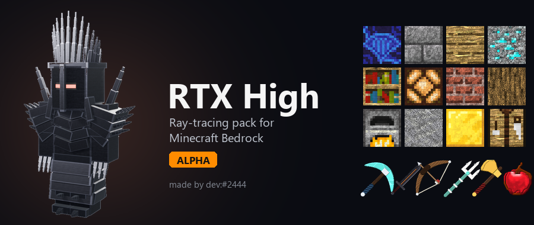

# RTX High

**A 128x ray-tracing pack for Minecraft Bedrock: every block and item redone with real reflections, plus true 3D armor.**

---

> **ALPHA** - this is an early version. It works for the author, but expect rough edges and changes. Bug reports are welcome.

Every block texture and every item of the game is rebuilt at 128x with full PBR data for RTX: colour, metalness/emissive/roughness and a normal map, so light, reflections and relief actually react to ray tracing. Metals mirror, gems and glass shine, lava and lamps glow, stone and wood get real depth.

Armor is no longer painted on: every armor set is a real 3D model, and leather armor turns into a different 3D outfit for each of the 16 dye colours.

## What it does

- **All 1,269 block textures** at 128x: shapes follow vanilla, surfaces use CC0 photo-scan micro detail
- **Material zones**: tools, books, paper, redstone and gems stay clean on wooden/stone workstations; iron parts are real metal
- **All 873 item textures** redone: hand-drawn tools, swords, bow, crossbow, trident, mace, fishing rod and more; every other item restyled with smooth edges and per-part shading
- **Real 3D armor**: dark-lord netherite with blade crown and glowing eyes, knight iron, crystal paladin diamond, sun-king gold, norman chainmail, steampunk copper
- **3D outfits for leather armor**: one outfit per dye colour (fursuits, hoodies, onesies, suit, robe, dresses ...), switched automatically by the dye
- Frameless clear glass, smooth water, glowing lava/magma/fire, custom sun, moon phases and End sky, volumetric fog

## Download

Download **`RTX-High-v0.14.0-alpha.mcaddon`** from the [releases page](../../releases) (or straight from this repository) and open it - Minecraft imports the packs.

1. Create or edit a world and open **Add-Ons**.
2. Activate the **Behavior Pack** and the **Resource Pack** of this add-on.
3. Requires Minecraft Bedrock **1.26.0 or newer**.

If items are missing in your world, check the world's *Experiments* page and enable *Beta APIs* and *Holiday Creator Features* as a fallback.

New to this? Follow **[SETUP-HELP.md](SETUP-HELP.md)** - it walks you through installing and starting it.

## What is in the package

The `.mcaddon` contains the **resource pack** plus a tiny behavior pack that only adds the Dev Book easter egg (a texture pack alone cannot add items).

## Dev Book

Every pack of mine carries a small easter egg: craft the **Dev Book** with **9 logs** (any wood type, 3x3 in a crafting table) and right-click it. It opens like a book: page 1 the credits, page 2 what this mod is, page 3 the GitHub links (Minecraft cannot open links, so they are shown as text). It also sits in the creative inventory under *Equipment*.

## Notes

- Block and item shapes are derived from Minecraft's vanilla textures, which belong to Mojang; this pack contains only derived versions. If Mojang objects, it will be taken down.
- Surface detail uses photo scans from **ambientCG** (ambientcg.com), licensed **CC0 1.0**.
- Not an official Minecraft product. Not approved by or associated with Mojang or Microsoft.

---

Made by **dev:#2444** - [github.com/hash2444](https://github.com/hash2444) - [rtx-high](https://github.com/hash2444/rtx-high)
